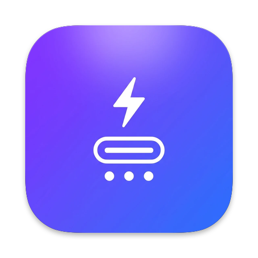
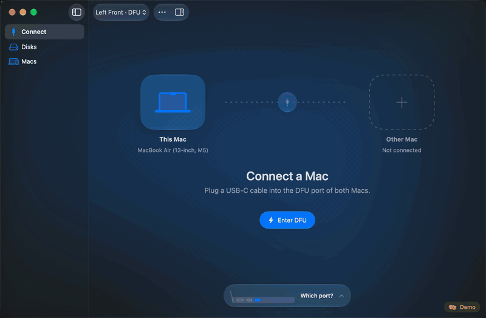
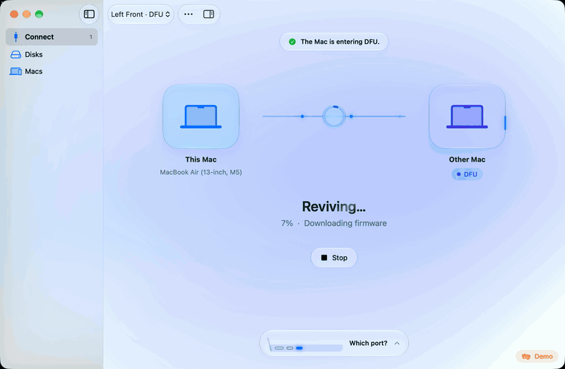
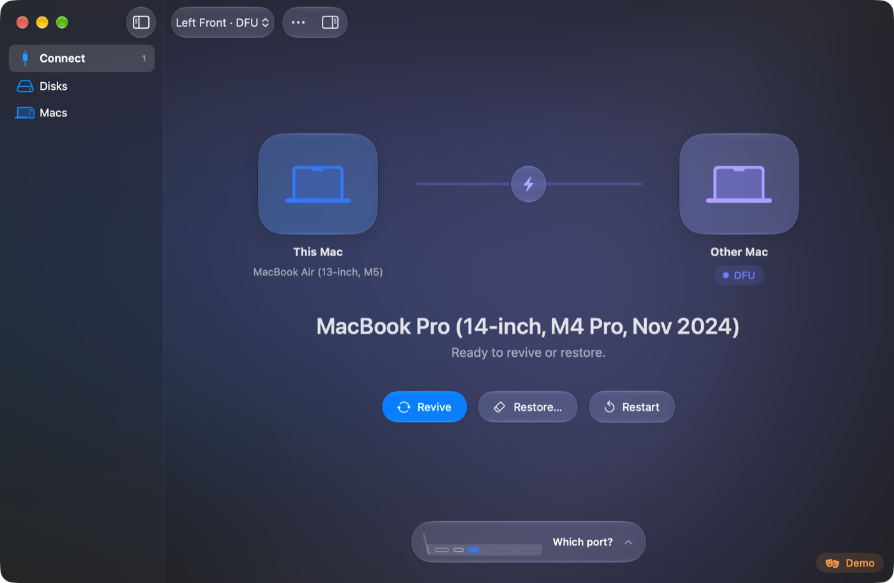
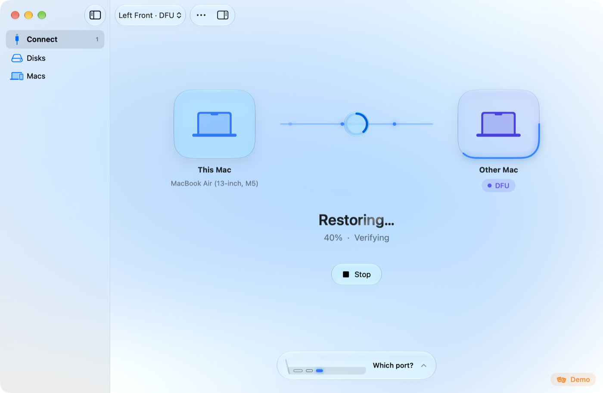
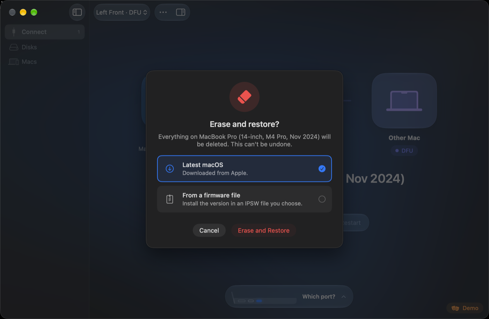
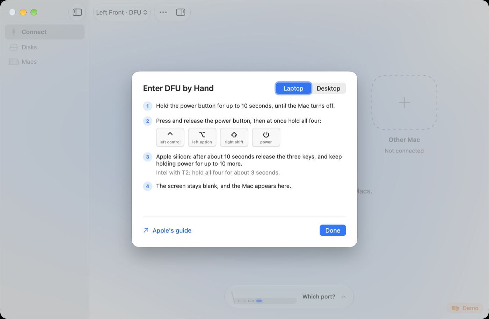
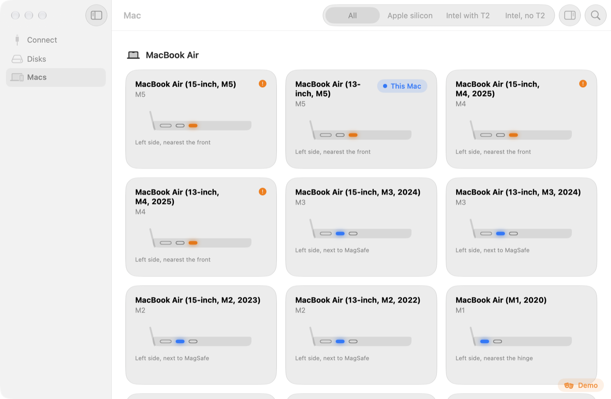
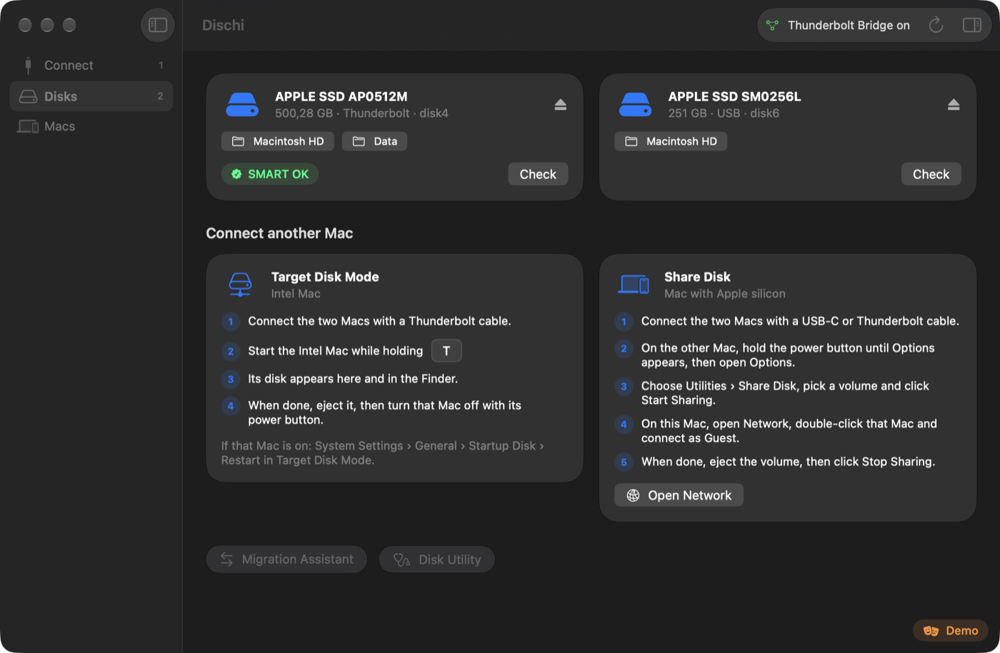
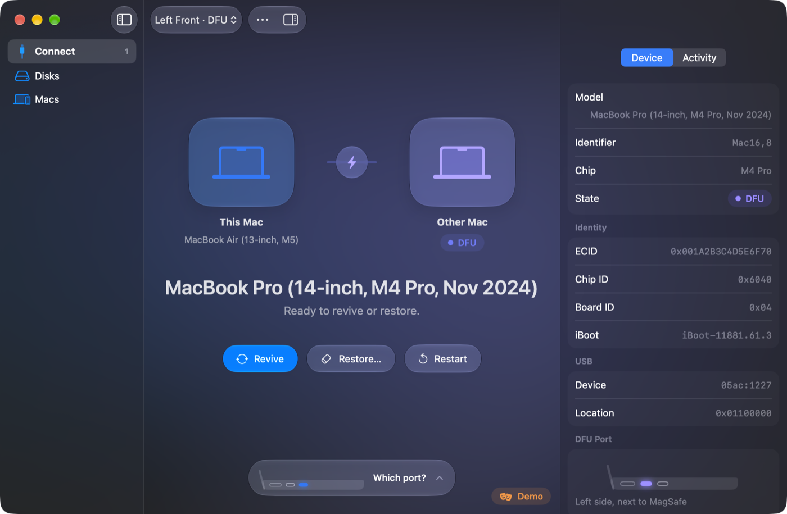

<p align="center">
  
</p>

<h1 align="center">Mac DFU Studio</h1>

<p align="center">
  <b>Put a Mac into DFU with one click. Revive it, restore it, or read its disk — from another Mac.</b><br/>
  A native macOS app for Apple silicon, built with SwiftUI and Liquid Glass.
</p>

<p align="center">
  <a href="https://github.com/iCosiSenpai/MacDFUDiagnostics/releases/latest"></a>
  
  
  
  
</p>

<p align="center">
  <a href="https://paypal.me/AlessioCosi"></a>
  <a href="https://buymeacoffee.com/icosisenpai"></a>
</p>

<p align="center">
  <a href="#download">Download</a> ·
  <a href="#what-it-does">What it does</a> ·
  <a href="#a-look-around">A look around</a> ·
  <a href="#which-macs">Which Macs</a> ·
  <a href="#security">Security</a> ·
  <a href="#building">Building</a>
</p>

<p align="center">
  
  
</p>

---

## Download

**[Get the latest release →](https://github.com/iCosiSenpai/MacDFUDiagnostics/releases/latest)** · [icosisenpai.app/macdfustudio](https://icosisenpai.app/macdfustudio/)

1. Open the `.dmg` and drag **Mac DFU Studio** to Applications.
2. To revive or restore, also install **[Apple Configurator](https://apps.apple.com/app/apple-configurator/id1037126344)** (free). Entering DFU and everything else works without it.

The app is signed with a Developer ID and notarized by Apple, and it keeps itself up to date.

| You need | |
| :-- | :-- |
| A Mac with **Apple silicon** to run the app | macOS 15 or later. On macOS 26 and later the interface uses Liquid Glass. |
| A **USB-C charge cable** | The one that comes with a MacBook is ideal. Not a Thunderbolt 3 cable, and no hub. |
| The other Mac's **DFU port** | The app shows you which one — on both Macs. |

## What it does

- **One-click DFU.** Sends the request over the USB-C cable itself, so nobody has to hold a key combination with perfect timing. Works on Macs with Apple silicon and on Intel Macs with the T2 chip, falling back to the T2 message automatically.
- **Revive and restore.** *Revive* reinstalls the firmware and keeps the data. *Restore* erases the Mac and installs the latest macOS — or the exact version in an IPSW file you choose. Progress is live, the Mac is kept awake, and a restore can only start from one explicit confirmation.
- **Knows what is connected.** DFU, recovery, a running Mac, a restore in progress, a cable that cannot carry DFU: each state is recognised the moment the cable goes in, and the screen changes with it.
- **Finds the port.** A drawing of the right port for this Mac and for the other one, covering 86 models, including the ones where Apple moved it.
- **Another Mac as a disk.** Step-by-step guides for Target Disk Mode (Intel) and Share Disk (Apple silicon), a read-only disk check, SMART status, safe eject, and shortcuts to Migration Assistant and Disk Utility.
- **Remembers what it did.** Every revive, restore and trip into DFU goes into a history kept on this Mac, which you can export as CSV. A notification says how a long restore ended, and the Dock icon shows how far it is.
- **Says what it needs.** A check on first launch, and Settings › Advanced afterwards, list the requirements with their state: notifications, an administrator account, the signed helper, a DFU port, Apple Configurator, an internet connection.
- **For the stubborn cases.** A guide to entering DFU by hand, restart over the cable, a port test, the serial console and debug USB — tucked away in one menu.

## A look around

<table>
  <tr>
    <td width="50%"><br/><sub><b>Connect.</b> This Mac, the cable, the other Mac — and the one thing to do next.</sub></td>
    <td width="50%"><br/><sub><b>Working.</b> The edge of the tile fills as the firmware is written.</sub></td>
  </tr>
  <tr>
    <td><br/><sub><b>Restore.</b> The latest macOS, or a firmware file of your choice.</sub></td>
    <td><br/><sub><b>By hand.</b> Apple's key combination, drawn key by key.</sub></td>
  </tr>
  <tr>
    <td><br/><sub><b>Macs.</b> Every supported model, with its DFU port lit.</sub></td>
    <td><br/><sub><b>Disks.</b> Target Disk Mode and Share Disk, with the steps beside them.</sub></td>
  </tr>
</table>

<p align="center">
  <br/>
  <sub><b>Inspector.</b> Model, ECID, chip and board IDs, iBoot version — and a log of everything that happened.</sub>
</p>

### Made to feel like a Mac app

One window, a sidebar, an inspector with the device, the activity and the history, a real Settings window (⌘,) and a full menu bar. Light and dark. English and Italian, switchable live. VoiceOver labels throughout.

The background is a Metal shader that takes the colour of the current state; a ripple runs through it when a Mac arrives. **All of it can be turned off** — in Settings › Effects, or with View › Reduce Effects (⌃⌘E) — and it follows *Reduce Motion* and *Reduce Transparency* on its own.

| Measured on a MacBook Air (M5) | Memory | CPU |
| :-- | --: | --: |
| Effects off | 66 MB | 0% |
| Effects on, Connect screen in front | 90–97 MB | about 6% of one core |
| Effects on, window in the background | — | 0% |

### Keyboard

| | | | |
| :-- | :-- | :-- | :-- |
| Enter DFU | <kbd>⌘</kbd><kbd>D</kbd> | Show or hide the inspector | <kbd>⌥</kbd><kbd>⌘</kbd><kbd>I</kbd> |
| Restart the other Mac | <kbd>⇧</kbd><kbd>⌘</kbd><kbd>R</kbd> | Connect · Disks · Macs | <kbd>⌘</kbd><kbd>1</kbd> <kbd>2</kbd> <kbd>3</kbd> |
| Refresh | <kbd>⌘</kbd><kbd>R</kbd> | Reduce effects | <kbd>⌃</kbd><kbd>⌘</kbd><kbd>E</kbd> |
| Copy a diagnostic report | <kbd>⇧</kbd><kbd>⌘</kbd><kbd>C</kbd> | Settings | <kbd>⌘</kbd><kbd>,</kbd> |

## Which Macs

| | DFU by cable | Revive · Restore | As a disk |
| :-- | :--: | :--: | :-- |
| **Apple silicon** — every Mac since 2020 | ✅ | ✅ | Share Disk, from macOS Recovery |
| **Intel with the T2 chip** — 2017 to 2020 | ✅ | ✅ restores the T2's firmware; macOS is then installed from Recovery | Target Disk Mode |
| **Intel without T2** — USB-C models, 2015 to 2019 | — | — | Target Disk Mode |

The DFU port is not always the obvious one. On most MacBooks it is the left port nearest the hinge — but on the 14-inch MacBook Pro with a base M4 or later, and on the MacBook Air from 2025, it is the one nearest the front; on the Mac mini from 2024 it is the middle port at the back. The app draws the right one for you. Apple's own list is [here](https://support.apple.com/120694).

## Security

This app asks for an administrator password and can erase a computer. It is built accordingly.

- **Updates are verified before they are installed.** A download must carry this developer's Developer ID signature — checked against an explicit requirement that names the team, not merely "a valid signature" — must be notarized by Apple, and must be the announced version and newer than the one running. Otherwise nothing is installed. The old app is only replaced once the new one is in place.
- **The root helper cannot be swapped.** Only the helper inside the app is ever used. Before it runs as root it is copied to a directory that only root can write to, and it is that copy whose signature is checked and that is executed.
- **Nothing is passed through a shell that could be re-read as a command.** Tools are launched with argument lists; the one script that must exist is quoted and unit-tested against hostile paths.
- **What a device says about itself is not trusted.** Identifiers read from USB are validated before they are shown, logged or handed to another tool.
- **No telemetry.** The only network request the app makes itself is the update check to GitHub. The history of operations is a file on your Mac, and Clear deletes it.

## Under the hood

- **Swift 6 and SwiftUI**, with Liquid Glass where the system has it and materials where it does not.
- **A small C bridge to IOKit** talks to the `AppleHPM` port controller and reads the USB tree.
- **Event-driven.** IOKit tells the app when something is plugged in or pulled out; nothing polls.
- **Apple's own tool does the writing.** Revive and restore run `cfgutil`, from Apple Configurator.
- **Shaders in Metal**, compiled into the app, drawn at a quarter resolution and paused when the window is not active.

### The helper, on its own

The helper that sends the vendor messages can be used from Terminal:

```bash
sudo "/Applications/MacDFUDiagnostics.app/Contents/MacOS/macdfu-vdm-helper" dfu --rid 0
```

Commands: `dfu` (tries Apple silicon, then T2), `dfu-silicon`, `dfu-t2`, `reboot`, `serial`, `debugusb`, `probe`. Add `--json` for machine-readable output.

### See every state without a second Mac

```bash
open -n /Applications/MacDFUDiagnostics.app --args -demo tour
```

`-demo` takes `tour`, `empty`, `booted`, `dfu`, `t2`, `recovery`, `cable` or `restoring`. The hardware is simulated — nothing real is touched — and a *Demo* badge says so. The clips above were recorded this way.

## Building

The source is published so it can be read and audited; see the [license](#license) for what that does and does not allow.

```bash
./build-app.sh               # builds MacDFUDiagnostics.app, ad-hoc signed
swift test                   # unit tests
Tools/sync-strings.sh        # refreshes the string catalog after changing text
scripts/capture-screens.sh   # retakes the screenshots, from the demo mode
scripts/release.sh           # tests, signs, notarizes, publishes, and updates the website
```

Requires Xcode 26 or later, with the Metal toolchain installed.

## Credits

The `AppleHPMLib` interface was worked out by the [Asahi Linux](https://github.com/AsahiLinux/macvdmtool) project and by [osy](https://github.com/osy/ThunderboltPatcher); the Intel T2 message comes from the research in [restorekit](https://github.com/fcjr/restorekit). Details are in [THIRD-PARTY-NOTICES.md](THIRD-PARTY-NOTICES.md).

The icon's artwork was generated with Google Gemini from a written brief; `Tools/GenerateIcon.swift` turns it into the app icon.

The procedures follow Apple's documentation: [How to revive or restore Mac firmware](https://support.apple.com/108900), [Identify the DFU port](https://support.apple.com/120694), and the Mac User Guide on Target Disk Mode and Share Disk.

## Support the project

Mac DFU Studio is free, with no account and no telemetry. If it saved you a trip to a repair shop, a donation keeps it going: [PayPal](https://paypal.me/AlessioCosi) or [Buy Me a Coffee](https://buymeacoffee.com/icosisenpai).

## License

Copyright © 2026 Alessio Cosi. All rights reserved.

Mac DFU Studio is **proprietary software**. You are welcome to download and use the app, and to read the source. You may not copy, modify, redistribute or reuse the source or the app. The full terms are in [LICENSE](LICENSE).

Mac DFU Studio is an independent project and is not affiliated with Apple Inc. Restoring a Mac erases it: back up first.
